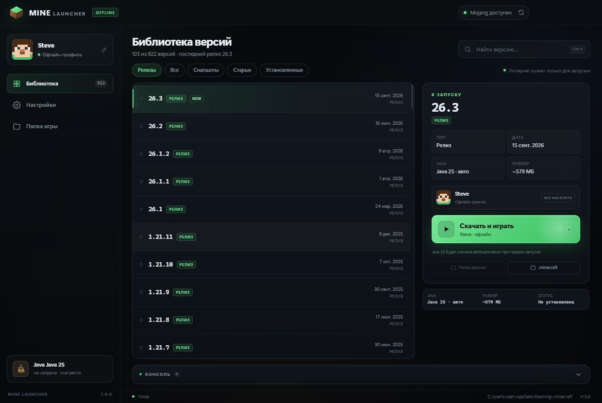

# MINE Launcher

Офлайн-лаунчер Minecraft для Windows: сам скачивает нужную версию, библиотеки, ресурсы и Java, а запускает игру по обычному нику — без аккаунта Mojang/Microsoft.

[Сайт лаунчера](https://stabrovskija8-boop.github.io/mine-launcher/) · [Установщик](https://github.com/stabrovskija8-boop/mine-launcher/releases/latest/download/MINE-Launcher-Setup-1.0.0.exe) · [Portable-архив](https://github.com/stabrovskija8-boop/mine-launcher/releases/latest/download/MINE-Launcher-1.0.0-win64.zip) · [Репозиторий](https://github.com/stabrovskija8-boop/mine-launcher)



## Скачать

| Файл | Размер | Что это |
| --- | --- | --- |
| `MINE-Launcher-Setup-1.0.0.exe` | ~103 МБ | Установщик: ярлыки в «Пуск» и на рабочем столе, удаление через «Приложения». Права администратора не нужны. |
| `MINE-Launcher-1.0.0-win64.zip` | ~140 МБ | Portable: распаковать в любую папку и запустить `MINE Launcher.exe`. |

SHA-256 установщика: `c3f842c4753a81bbfc9b80e49f2acefed44363af88034cdbbb12ccdacf5eda39`

Сборка не подписана, поэтому SmartScreen может предупредить: «Подробнее» → «Выполнить в любом случае».

## Быстрый старт

1. Запустите установщик (или распакуйте portable-архив) и откройте **MINE Launcher**.
2. Введите ник (латиница, цифры, `_`, 2–16 символов) — это имя игрока в офлайн-режиме.
3. Выберите версию в списке (например, `26.3`) и нажмите **«Играть»**.
4. Первый запуск — самый долгий: лаунчер скачает Java (~58 МБ), клиент, библиотеки и ресурсы (в сумме ~600 МБ для 26.3). Дальше запуск занимает секунды, всё уже лежит на диске.

Запуск из исходников: дважды кликните **`Запустить лаунчер.bat`** — если Electron ещё не установлен, `.bat` сам выполнит `npm install` (нужен [Node.js](https://nodejs.org)).

Запуск с консолью (видно ошибки): `Запустить лаунчер.bat --console`
Запуск из терминала: `npm start`

## Что умеет

- Список версий с сервера Mojang + уже установленные локальные версии.
- Фильтры: релизы, снапшоты, старые версии, **альфы**, **беты** и установленные.
- Офлайн-вход по нику: UUID генерируется как UUID v3 от `OfflinePlayer:<ник>`.
- Автоматическая загрузка Java нужной версии (Azul Zulu, при недоступности — Adoptium Temurin).
- Поддержка современных и старых версий: `arguments` и `minecraftArguments`, правила ОС, нативы, virtual assets, `inheritsFrom`.
- **Модификации**: установка Fabric, Quilt, Forge, NeoForge прямо из лаунчера и OptiFine через официальный установщик. Установленная версия сразу появляется в библиотеке.
- **Редактор скина**: карандаш, ластик, заливка, пипетка, палитра, отмена/повтор, шаблон Стива, импорт и экспорт PNG. Скин применяется к персонажу при запуске через ресурспак.
- Прогресс скачивания, скорость, отмена, лог запуска прямо в окне.
- Настройки: ник, папка игры, оперативная память, свой путь к Java, дополнительные JVM-аргументы, разрешение окна/полный экран.

## Где что лежит

| Что | Путь |
| --- | --- |
| Настройки, Java, логи | `%APPDATA%\MINE Launcher` |
| Файл скина | `%APPDATA%\MINE Launcher\skin\skin.png` |
| Ресурспак со скином | `<папка игры>\resourcepacks\MINE-Skin` |
| Игра (по умолчанию) | `%APPDATA%\.minecraft` |

Папку игры можно сменить в настройках — удобно, чтобы не трогать существующий `.minecraft` от другого лаунчера.

## Требования

- Windows 10/11, 64-битная.
- Интернет для первого скачивания версии.
- 2 ГБ ОЗУ минимум (рекомендуется 4 ГБ и больше — выставляется в настройках).
- Java устанавливать вручную не нужно: лаунчер скачает её сам. Если Java уже есть — укажите путь в настройках, и загрузка не понадобится.

## Ограничения

- Это офлайн-режим: на серверы с `online-mode=true` зайти нельзя.
- Скин работает в одиночной игре и на офлайн-серверах (версии 1.6+). В альфах и бетах ресурспаков нет — там будет стандартный Стив.
- Скорость скачивания зависит от соединения с серверами Mojang/Azul; при обрыве загрузка повторяется автоматически.
- Forge/NeoForge/OptiFine устанавливаются официальными установщиками: для Forge и NeoForge загрузка библиотек идёт внутри установщика, для OptiFine нужно нажать «Install» в его окне.
- Для OptiFine установщик `.jar` нужно предварительно скачать с [optifine.net](https://optifine.net/downloads) — лаунчер поможет выбрать файл.

## Сборка установщика

Готовый установщик лежит в релизе. Пересобрать его можно [Inno Setup 6](https://jrsoftware.org/isinfo.php):

```powershell
& "$env:LOCALAPPDATA\InnoSetup6\ISCC.exe" build\setup.iss
```

На выходе — `dist\MINE-Launcher-Setup-1.0.0.exe`. Скрипт `build/setup.iss` берёт файлы из `dist\MINE Launcher`, а `build/icon.ico` и `build/wizard.png` — иконку приложения и картинку мастера установки.
